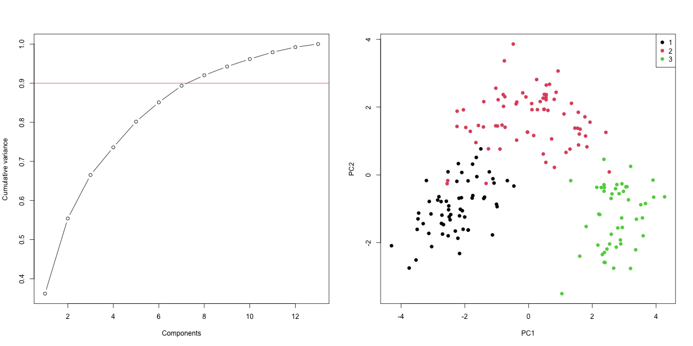

# Wine Dimension Reduction

Standardized PCA, variance retention, reconstruction error, and SVD pseudoinverses.

## Run

Requires R 4.4+ and packages MASS and jsonlite.

```r
install.packages(c("MASS", "jsonlite"))
```

```sh
Rscript scripts/run.R
Rscript tests/checks.R
```

Generated metrics and figures are saved in `results/`. Read [input provenance](data/README.md) and [method changes](docs/provenance.md).

## Executed results

On the supplied 178-row wine dataset, **8 components retain 92.02% of standardized variance**. Reconstruction error is measured on standardized variables; original-scale feature errors have different units. Cultivar coloring is exploratory and is not a held-out classification result.



## Reproducibility and scope

Seeds are fixed in source. Validation uses numerical invariants or input/split checks. This is a maintained reconstruction of the supplied work; methodological corrections and newly generated data mean some results intentionally differ from the original reports. Original PDFs are omitted to avoid publishing student identifiers.

## Reports

`report.html` is a ready-to-open summary. To render the R Markdown version after running the analysis, install `rmarkdown` and `knitr`, install Pandoc, and run `rmarkdown::render("report.Rmd")` from the repository root. The optional R Markdown rendering was not executed in the local environment because Pandoc is unavailable.

## Python companion

The same 178-row dataset now has a Python PCA companion under `python/`. Both implementations retain eight components for at least 90% variance; this is descriptive compression, not held-out classification performance.

```sh
python -m pip install -r python/requirements.txt
python python/analysis.py
python -m unittest discover -s python/tests
```

See [Python methodology and measured results](python/README.md). The original R workflow remains available.
