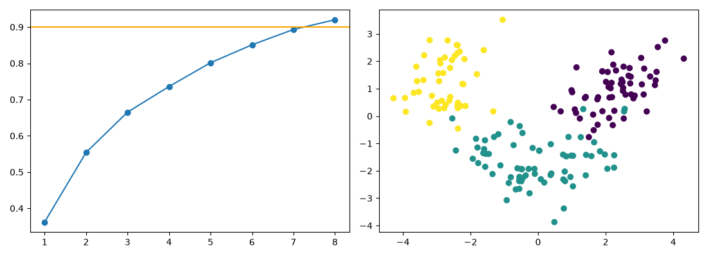

# Wine PCA Python Extension

A Python companion to the existing wine dimension-reduction R repository.

**Author and maintainer:** Abhinav Tanwar.

## Run

Requires Python 3.12. Install dependencies with `python -m pip install -r requirements.txt`.

```sh
python analysis.py
python -m unittest discover -s tests
```

## Methods and limitations

Adds a Python companion to the existing Wine Dimension Reduction R project rather than creating a duplicate public repository. Class is excluded from the PCA input. All-row standardization is used for this explicitly descriptive compression analysis. Eight components should retain at least 90% variance; reconstruction is assessed in standardized units. This is not held-out classification performance.

## Measured results


[Full calculated metrics](results/metrics.json) · [Input provenance](data/README.md) · [Method changes](docs/methodology.md). Open `report.html` for the visual summary.



The clean notebook in `notebooks/` delegates to the same module. Notebook cells were syntax-checked with outputs cleared; native scripts and tests were executed.
